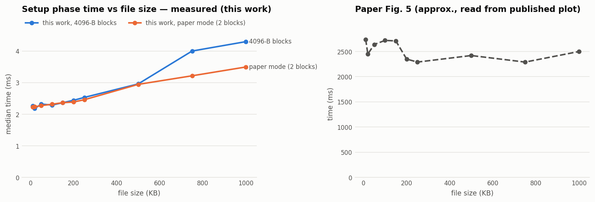
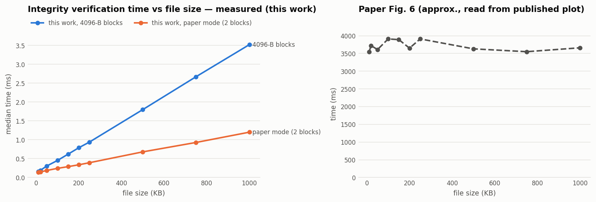
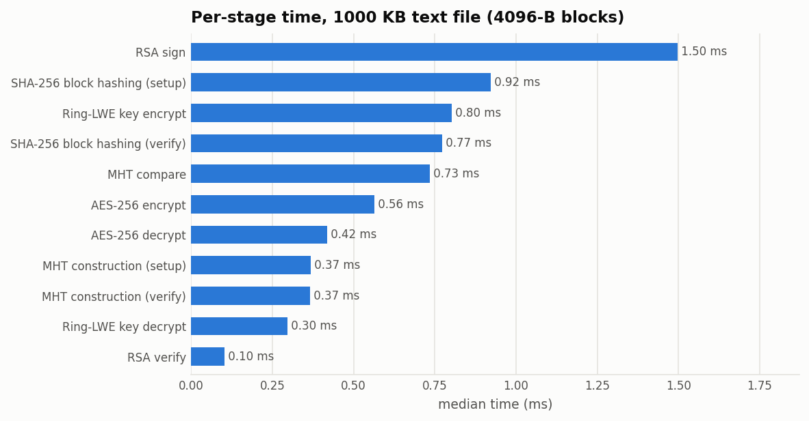
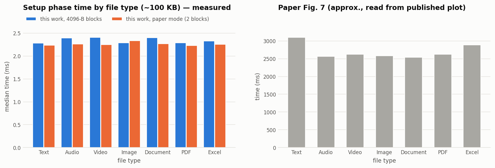
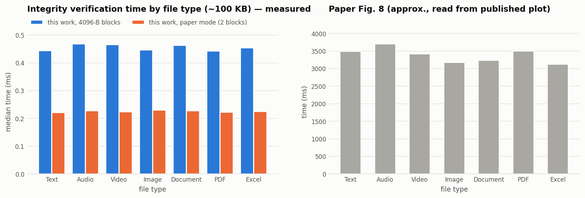

# Performance Results (reproduction of paper §VI)

> **Two kinds of numbers appear in this file; they are never mixed.**
> * **Measured (this work):** produced by `python -m evaluation.paper_benchmark --runs 30 --warmup 3`
>   on the machine below. Raw data: `evaluation/results/table1_sizes.csv`, `table2_types.csv`.
> * **Paper (approx.):** read **by eye** from the published Figs. 5–8. The paper gives no numeric
>   tables, so these values carry roughly ±30 ms reading error.
>
> The absolute values are **not comparable**: different language (Python vs Java), hardware, OS,
> and, most importantly, unknown measurement boundaries in the paper (see §4).

## 1. Environment

| Item | This work | Paper (§VI) |
|---|---|---|
| Language / runtime | CPython 3.14.4 | Java 1.8 |
| Crypto libraries | `cryptography` 50.0.2 (OpenSSL), numpy 2.4.4 | not stated |
| Cloud SDK | `supabase` 2.33.0 / `dropbox` 12.2.3 (**not used in these runs**; no network) | Dropbox Core SDK 2.0-beta, Jackson 2.6.1 |
| OS | Windows 11 (10.0.26200), AMD64 | Windows 7 Professional, 32-bit |
| CPU / cores | Intel64 Family 6 Model 151 (12 logical CPUs) | Intel Core i3 @ 2.40 GHz |
| RAM | not recorded | 4 GB |
| AES | AES-256-GCM | AES-256 (mode not stated) |
| Key encryption | Ring-LWE P2 (n=512, q=12289) | Ring-LWE (parameters not stated) |
| Signature | RSA-3072 PSS-SHA256 | RSA (size/padding not stated) |
| Repetitions | 3 warm-up + 30 timed, **median** reported | not stated |
| One-time key generation | RSA-3072: 53.4 ms · Ring-LWE P2: 5.2 ms (not in setup time) | not stated |

Timer: `time.perf_counter`. **Setup time** = AES encryption + Ring-LWE key encryption + SHA-256
block hashing + MHT construction + MHT-file serialization + RSA signing. **Verification time** =
RSA signature verification + MHT parsing + SHA-256 block hashing + MHT construction + MHT
comparison. Decryption is reported separately. No network I/O is included.

Two MHT blocking modes were measured: **4096** (4096-byte blocks, the default) and **paper**
(2 blocks / 3-node tree, as in paper §V-C(2)).

## 2. Experiment 1: file sizes (paper Table I, Figs. 5–6)

Text files, KB = 1024 bytes. Median of 30 runs, milliseconds.

| Size (KB) | Blocks (4096) | Setup 4096 | Setup paper-mode | Verify 4096 | Verify paper-mode | Decrypt 4096 | **Paper Fig. 5 setup ≈** | **Paper Fig. 6 verify ≈** |
|---:|---:|---:|---:|---:|---:|---:|---:|---:|
| 10 | 3 | 2.260 | 2.235 | 0.160 | 0.139 | 0.281 | 2740 | 3540 |
| 20 | 6 | 2.179 | 2.235 | 0.189 | 0.147 | 0.266 | 2450 | 3720 |
| 50 | 13 | 2.322 | 2.272 | 0.305 | 0.186 | 0.294 | 2640 | 3610 |
| 100 | 26 | 2.290 | 2.316 | 0.451 | 0.242 | 0.285 | 2720 | 3910 |
| 150 | 38 | 2.365 | 2.366 | 0.618 | 0.287 | 0.298 | 2710 | 3890 |
| 200 | 51 | 2.441 | 2.386 | 0.787 | 0.336 | 0.317 | 2350 | 3650 |
| 250 | 63 | 2.532 | 2.459 | 0.938 | 0.391 | 0.325 | 2290 | 3910 |
| 500 | 126 | 2.959 | 2.944 | 1.797 | 0.678 | 0.396 | 2420 | 3630 |
| 750 | 188 | 3.999 | 3.216 | 2.669 | 0.928 | 0.625 | 2290 | 3550 |
| 1000 | 251 | 4.297 | 3.495 | 3.518 | 1.200 | 0.716 | 2500 | 3660 |

(Decrypt = median Ring-LWE key decryption + median AES decryption, run after a successful verification.)




### Per-stage breakdown (median ms, 4096-byte blocks)

| Size (KB) | AES enc | Ring-LWE enc | SHA-256 blocks | MHT build | RSA sign | RSA verify | SHA-256 (verify) | MHT build (verify) | MHT compare | Ring-LWE dec | AES dec |
|---:|---:|---:|---:|---:|---:|---:|---:|---:|---:|---:|---:|
| 10 | 0.012 | 0.769 | 0.012 | 0.011 | 1.441 | 0.071 | 0.010 | 0.008 | 0.019 | 0.268 | 0.013 |
| 100 | 0.027 | 0.735 | 0.075 | 0.047 | 1.377 | 0.066 | 0.072 | 0.041 | 0.088 | 0.256 | 0.029 |
| 500 | 0.113 | 0.762 | 0.372 | 0.193 | 1.408 | 0.081 | 0.364 | 0.184 | 0.382 | 0.278 | 0.118 |
| 1000 | 0.564 | 0.803 | 0.922 | 0.368 | 1.498 | 0.103 | 0.772 | 0.366 | 0.734 | 0.297 | 0.419 |



## 3. Experiment 2: file types (paper Table II, Figs. 7–8)

Real, well-formed files generated by `evaluation/sample_files.py` (validated in the tests: WAV
readable by `wave`, PNG by Pillow, PDF by pypdf, DOCX/XLSX as valid ZIP + XML, AVI RIFF structure).
Median of 30 runs, milliseconds.

| # | Type | File | Bytes | Setup 4096 | Setup paper-mode | Verify 4096 | Verify paper-mode | **Paper Fig. 7 setup ≈** | **Paper Fig. 8 verify ≈** |
|---:|---|---|---:|---:|---:|---:|---:|---:|---:|
| 1 | Text | .txt | 102 400 | 2.279 | 2.234 | 0.443 | 0.220 | 3100 | 3490 |
| 2 | Audio | .wav | 102 400 | 2.393 | 2.262 | 0.468 | 0.227 | 2560 | 3700 |
| 3 | Video | .avi | 101 872 | 2.409 | 2.249 | 0.464 | 0.223 | 2620 | 3410 |
| 4 | Image | .png | 102 488 | 2.291 | 2.337 | 0.446 | 0.230 | 2580 | 3170 |
| 5 | Document | .docx | 102 431 | 2.404 | 2.272 | 0.463 | 0.227 | 2540 | 3230 |
| 6 | PDF | .pdf | 102 464 | 2.288 | 2.232 | 0.442 | 0.222 | 2620 | 3500 |
| 7 | Excel | .xlsx | 102 499 | 2.331 | 2.255 | 0.454 | 0.224 | 2890 | 3120 |




## 4. Analysis and comparison with the paper

1. **File type does not matter (agrees with the paper's intent).** All seven types take the same
   time within noise (setup 2.28–2.41 ms, verify 0.44–0.47 ms). This is expected: every stage works
   on the **AES ciphertext**, which is indistinguishable from random bytes whatever the file type.
   The paper's Fig. 7/8 spread (≈2540–3100 ms, ≈3120–3700 ms) is ±10 % around the mean with no
   consistent ordering, which we interpret as measurement noise (likely network-dominated) rather than
   a type effect.
2. **Setup time is dominated by fixed public-key costs for small files.** RSA-3072 signing
   (≈1.4 ms) and Ring-LWE encryption (≈0.75 ms) are constant. AES and SHA-256 grow linearly
   but stay below 1 ms up to 1 MB. So setup is nearly flat from 10 to 250 KB and rises only above
   500 KB. The paper's Fig. 5 is also roughly flat (no size trend), consistent with a fixed cost
   dominating, though at a much larger scale.
3. **Verification time grows linearly with size,** since the whole ciphertext must be re-hashed. In
   4096-block mode it also grows with the node count (MHT build + node-by-node comparison, 251
   leaves at 1 MB). Paper mode (3 nodes) is ≈3× cheaper at 1 MB but **cannot localize** the modified
   region (only "first half / second half"). The paper's Fig. 6 shows no size trend, which again
   points to a dominant fixed cost in their measurement.
4. **Absolute values differ by ~1000×** (ours ≈2–4 ms, the paper's ≈2.3–3.9 s). The paper does not
   state what its timers include. A Core i3 running Java AES/SHA-256/RSA over ≤1 MB cannot take
   seconds of pure computation, so the published times very likely include Dropbox network transfer
   (verification includes a download, which would explain verify > setup in every paper data point),
   JVM warm-up, and/or key generation. **We therefore claim reproduction of the experimental
   procedure and of the qualitative findings, not of the paper's numbers.**
5. **Noise.** Standard deviations for total setup were 0.13–0.80 ms (see `*.std` columns in the
   CSV). The jump in AES time between 500 and 750 KB (0.11 → 0.45 ms) appears in both modes and is
   consistent with a memory-allocation threshold in the runtime; it does not affect the conclusions.

## 5. Network timings (cloud storage)

**Not measured**: no Supabase or Dropbox credentials were available in this environment. With
credentials, `python -m evaluation.paper_benchmark --cloud supabase` (or `--cloud dropbox`) adds
`net.upload_total_ms` and `net.download_total_ms` columns, measured against the real provider, to
the same CSVs. Supabase upload time includes the read-back used to confirm each upload. Note that the
paper's network component was Dropbox in 2017, so even then the numbers would not be directly
comparable.

## 6. Ring-LWE decryption-failure study (supporting a design decision)

`python -m evaluation.rlwe_failure_rate --trials 3000` → `evaluation/results/rlwe_failure_rate.json`

| Params | Bits tested | 1 coefficient / bit: bit errors | ⇒ est. failure per 256-bit key | 2 coefficients / bit (implemented): bit errors |
|---|---:|---:|---:|---:|
| P1 (256, 7681) | 384 000 | 6 | 0.40 % | **0** |
| P2 (512, 12289) | 768 000 | 48 | 1.59 % | **0** |

## 7. How to reproduce

```bash
python -m evaluation.paper_benchmark --runs 30 --warmup 3     # ~1 min, writes evaluation/results/
python -m evaluation.paper_benchmark --plot-only              # redraw figures from the CSVs
python -m evaluation.paper_benchmark --cloud supabase         # include real Supabase transfers
python -m evaluation.rlwe_failure_rate --trials 3000
```
