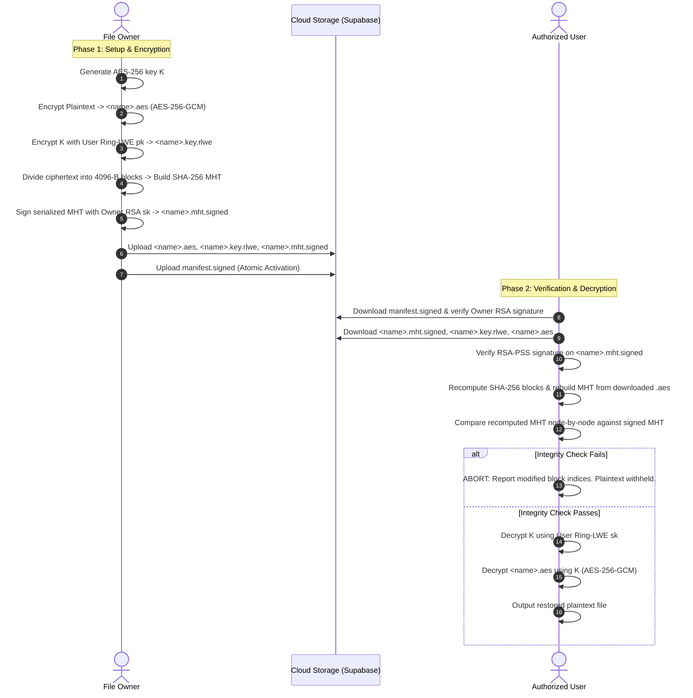

# Secure File Sharing System

> **Integrity Verification & Post-Quantum Encrypted File Sharing in Cloud Storage**  
> An implementation and architectural extension of the IEEE research paper:  
> *“Design and Implementation of an Efficient Tool to Verify Integrity of Files Uploaded to Cloud Storage”* (Parida et al., IEEE CSNT 2017).

[](https://www.python.org/)
[](#16-license)
[](#11-evaluation-and-results)
[.

[](https://www.python.org/)
[](#16-license)
[](#11-evaluation-and-results)
[%20%7C%20Dropbox%20%7C%20Local-green.svg)](#8-installation-and-setup)

---

## Table of Contents
1. [Project Overview](#1-project-overview)
2. [Research Motivation](#2-research-motivation)
3. [Key Features](#3-key-features)
4. [Research Paper](#4-research-paper)
5. [System Architecture](#5-system-architecture)
6. [Technology Stack](#6-technology-stack)
7. [Project Structure](#7-project-structure)
8. [Installation and Setup](#8-installation-and-setup)
9. [Usage Guide](#9-usage-guide)
10. [Research Methodology](#10-research-methodology)
11. [Evaluation and Results](#11-evaluation-and-results)
12. [Security Considerations](#12-security-considerations)
13. [Contributions and Attribution](#13-contributions-and-attribution)
14. [Limitations](#14-limitations)
15. [Troubleshooting](#15-troubleshooting)
16. [License](#16-license)
17. [Acknowledgments and References](#17-acknowledgments-and-references)

---

## 1. Project Overview

The **Secure File Sharing System** (internally designated **Ring Crypter**) is an end-to-end cryptographic file-sharing and cloud-storage integrity verification framework. It solves the fundamental problem of sharing confidential files through untrusted, third-party cloud service providers without relinquishing security or data authenticity.

In standard cloud storage architectures, clients must trust cloud providers not to modify, corrupt, truncate, or substitute stored files. This project addresses this vulnerability by implementing an authenticated integrity protocol that binds:
1. **AES-256-GCM** authenticated symmetric file encryption.
2. **Post-Quantum Ring Learning With Errors (Ring-LWE)** lattice-based public-key encryption for wrapping and exchanging symmetric file keys.
3. **SHA-256 Merkle Hash Trees (MHT)** built over ciphertext blocks to provide hierarchical, tamper-evident cryptographic proofs.
4. **RSA-PSS (3072-bit)** digital signatures over authenticated MHT manifests to guarantee non-repudiation and origin authenticity.
5. **Gated Pre-Decryption Integrity Verification**, enforcing the strict invariant that ciphertext is never decrypted unless its digital signature, tree root, intermediate nodes, and version history have been independently recomputed and verified.

The system features both an interactive web dashboard (built with Streamlit and Pyvis) and an automated command-line interface (CLI), with built-in integration for **Supabase Storage** (default), **Dropbox**, and **Offline Local Storage**.

---

## 2. Research Motivation

Modern distributed computing environments rely heavily on cloud object stores (e.g., Supabase, Dropbox, AWS S3, Google Cloud Storage). However, storing sensitive files on commercial clouds introduces critical security and trust challenges:

* **Untrusted and Malicious Cloud Providers:** The cloud server is treated as an *untrusted adversary* that may suffer data corruption, experience bit-rot, tamper with records, or collude with unauthorized third parties.
* **The Post-Quantum Threat to Key Distribution:** Traditional public-key schemes like RSA or elliptic curves (ECDH) used for symmetric key exchange will be vulnerable to Shor's algorithm on quantum computers. Lattice-based cryptography (such as Ring-LWE) provides post-quantum security guarantees against quantum adversaries.
* **Integrity Verification Before Plaintext Release:** Many conventional systems decrypt data before checking integrity, creating padding oracle or ciphertext-manipulation vulnerabilities. A secure architecture must verify integrity *strictly before* decryption keys are used.
* **Localization of Tampering:** Standard cryptographic hashes (e.g., SHA-256 over a whole file) indicate that corruption occurred, but cannot identify *which portion* was altered. Merkle Hash Trees allow logarithmic verification and pinpoint the exact modified blocks.
* **Rollback and Replay Attacks:** An adversarial storage provider could silently replace the current version of a file with an older, validly signed version. A secure sharing architecture requires persistent version tracking and hash-chained version manifests.
* **Dynamic Block-Level Updates:** Whole-file re-encryption and re-uploading for minor edits is bandwidth-prohibitive. Applying authenticated block-level encryption allows modifying single 4096-byte blocks with $O(\log n)$ tree updates while reusing unchanged ciphertext.

---

## 3. Key Features

### Core Cryptographic Pipeline
* **Hybrid Post-Quantum Cryptography:** Combines AES-256-GCM for high-throughput symmetric data encryption with Ring-LWE (LPR lattice scheme) for post-quantum key encapsulation.
* **Hierarchical Tamper Localization:** Uses SHA-256 binary Merkle Hash Trees over 4096-byte blocks to localize corruptions to specific block indices.
* **Non-Repudiation via Digital Signatures:** RSA-3072 with RSASSA-PSS and SHA-256 signs the complete Merkle tree structure, version metadata, and file hashes.
* **Fail-Safe Decryption Gate:** Decryption strictly requires a validated cryptographic `VerificationReport` bound by SHA-256 digest to the exact downloaded ciphertext bytes.

### Cloud Storage & Versioning Architecture
* **Seamless Supabase Storage Integration:** Uses official Python SDKs with private buckets, atomic multi-object uploads, and read-back SHA-256 validation.
* **Single `.env` Credential Management:** All credentials (`SUPABASE_URL`, `SUPABASE_SECRET_KEY`, `SUPABASE_BUCKET`) are loaded automatically on startup via `securecloud.envfile`.
* **Atomic Versioning & Anti-Rollback:** Releases versioned directories (`<file>/v000001-<id>/...`) activated atomically by a signed manifest (`manifest.signed`). Rollback attacks are rejected via a persistent local `VersionTrustStore`.
* **Multi-Backend Support:** Switch between **Supabase Storage** (default), **Dropbox**, and an offline **Local Folder**.

### Advanced Architectural Enhancements (Beyond the Paper)
* **RCB1 Per-Block Dynamic Updates:** An opt-in authenticated format encrypting individual 4096-byte blocks with independent nonces and Associated Authenticated Data (AAD). Re-encrypts and uploads only edited blocks, executing $O(\log n)$ Merkle tree path updates via content-addressed storage.
* **Attack & Tampering Simulation Suite:** Built-in tools to simulate ciphertext bit-flipping, file truncation, MHT tampering, key substitution, unauthorized signer attacks, interrupted uploads, and manifest replay.
* **Interactive Visualization Dashboard:** Streamlit-based user interface with Pyvis hierarchical tree rendering, node inspectors, and KPI tiles.

---

## 4. Research Paper

This system implements, evaluates, and extends the security architecture described in the following IEEE publication:

* **Title:** *Design and Implementation of an Efficient Tool to Verify Integrity of Files Uploaded to Cloud Storage*
* **Authors:** P. Parida, S. Konhar, B. Mishra, and D. Jena
* **Publication Venue:** 2017 7th International Conference on Communication Systems and Network Technologies (CSNT)
* **Pages:** 62–66
* **Publisher:** IEEE
* **Date of Conference:** 11–13 November 2017
* **DOI:** [10.1109/CSNT.2017.13](https://doi.org/10.1109/CSNT.2017.13)
* **IEEE Xplore Record:** [8418512](https://ieeexplore.ieee.org/document/8418512)

### Relation to the Research Paper
| Architecture Aspect | CSNT 2017 Paper | Our Implementation |
|---|---|---|
| **Symmetric Encryption** | AES-256 (unspecified cipher mode) | AES-256-GCM (authenticated encryption, random 96-bit nonce) |
| **Key Encapsulation** | Ring-LWE (LPR, scheme details omitted) | Lyubashevsky-Peikert-Regev (LPR) in $\mathbb{Z}_q[x]/(x^n+1)$, P1 ($n=256$) & P2 ($n=512$) |
| **Digital Signatures** | RSA (size/padding unspecified) | RSA-3072, RSASSA-PSS, SHA-256, MGF1 |
| **Integrity Structure** | 2-leaf, 3-node demonstration MHT | 4096-byte block binary MHT ($n$ leaves) + `--paper-mode` (3 nodes) |
| **Cloud Provider** | Dropbox (2017 Java SDK) | Supabase Storage (default, private bucket) + Dropbox + Local |
| **Dynamic Updates** | Proposed as theoretical future work (Section VII) | Fully implemented: signed version manifests, hash-chaining, atomic activation |
| **Block-Level Updates** | Not proposed in the paper | Implemented as novel **RCB1** per-block authenticated format |

---

## 5. System Architecture

The system operates across three distinct roles: the **File Owner**, the **Untrusted Cloud Storage Provider**, and the **Authorized User / Receiver**.



### Architectural Data Flow

1. **Storage Layout:** Files are structured in versioned partitions:
   ```text
   <filename>/
   ├── manifest.signed                          <-- Signed active pointer (written LAST)
   ├── v000001-<uuid>/
   │   ├── <filename>.aes                       <-- Encrypted ciphertext
   │   ├── <filename>.key.rlwe                  <-- Ring-LWE encapsulated file key
   │   └── <filename>.mht.signed                <-- RSA-signed Merkle tree & metadata
   └── v000002-<uuid>/
       └── ...
   ```
2. **Atomic Publication:** Objects are uploaded and validated via SHA-256 read-back before `manifest.signed` is published. If an upload is interrupted, the uncommitted folder is never referenced.
3. **Pre-Decryption Integrity Barrier:** The decryption function `securecloud.workflow.decrypt_verified()` cryptographically asserts that the hash of the data being decrypted matches the hash verified in the `VerificationReport`.

---

## 6. Technology Stack

* **Core Programming Language:** Python ≥ 3.10 (tested and verified on CPython 3.10–3.14 on Windows 11 and Linux)
* **Cryptographic Primitives:**
  * [`cryptography`](https://cryptography.io/) (≥ 42.0): OpenSSL bindings for AES-256-GCM authenticated encryption, RSA-3072 RSASSA-PSS key generation and verification, SHA-256 hashing.
  * [`numpy`](https://numpy.org/) (≥ 1.26): High-performance polynomial modular arithmetic for Ring-LWE over $\mathbb{Z}_q[x]/(x^n+1)$.
* **Cloud Storage SDKs:**
  * [`supabase`](https://github.com/supabase/supabase-py) (≥ 2.10): Official Supabase client for private storage bucket management and object transfers.
  * [`dropbox`](https://www.dropbox.com/developers/documentation/python) (≥ 12.0): Official Dropbox API client (optional alternative backend).
* **Web Interface & Visualization:**
  * [`streamlit`](https://streamlit.io/) (≥ 1.35.0, tested on 1.66.0): Reactive web dashboard.
  * [`pyvis`](https://pyvis.readthedocs.io/) (≥ 0.3.2): Interactive HTML5 Canvas network visualizer for binary Merkle trees.
* **Testing & Benchmarking:**
  * [`pytest`](https://docs.pytest.org/) (≥ 8.0.0): Automated test execution framework.
  * [`matplotlib`](https://matplotlib.org/) (≥ 3.8): Automated generation of performance and reproduction charts.

---

## 7. Project Structure

```text
Secure-file-sharing-system/
├── app.py                             # Interactive Streamlit Merkle Tree Visualizer (Page 1)
├── requirements.txt                   # Production Python package dependencies
├── pytest.ini                         # Pytest configuration and test markers
├── .gitignore                         # Excludes secrets (.env), keys/, caches, and local data
│
├── .streamlit/
│   └── config.toml                    # Streamlit configuration file
│
├── merkle/                            # Core Merkle Tree implementation (reused & extended)
│   ├── chunker.py                     # Fixed-size (4096-B) byte stream chunker
│   ├── node.py                        # MerkleNode class (hashes, left/right pointers, tree depth)
│   ├── tree.py                        # MerkleTree builder, pair hashing, odd-leaf handling
│   ├── proof.py                       # O(log n) audit path extraction and verification
│   ├── tamper.py                      # Recursive tree diffing & modified leaf localization
│   └── updater.py                     # O(log n) incremental ancestor path recomputation
│
├── securecloud/                       # Research paper implementation & cloud engine
│   ├── aes_cipher.py                  # AES-256-GCM encryption, decryption, nonce generation
│   ├── rlwe.py                        # Ring-LWE (LPR) scheme, P1/P2 parameter sets, Gaussian sampler
│   ├── signature.py                   # RSA-3072 keygen, RSASSA-PSS signing, armored envelopes
│   ├── keys.py                        # Identity management (Owner RSA+RLWE, User RLWE)
│   ├── mht.py                         # MHT serialization, format v1/v2/v3, header-bound verification
│   ├── storage.py                     # Abstract storage: SupabaseStorage, DropboxStorage, LocalFolder
│   ├── versioning.py                  # VersionedRepository, signed manifests, anti-rollback store
│   ├── blockmode.py                   # Novel RCB1 per-block authenticated format & dynamic sync
│   ├── workflow.py                    # High-level Setup, Update, Verify, and Gated Decrypt phases
│   ├── envfile.py                     # Minimal .env parser loading secrets on startup
│   └── cli.py                         # "Ring Crypter" unified command-line interface
│
├── pages/
│   └── 1_Ring_Crypter_Secure_Cloud.py # Streamlit multi-page dashboard for cloud sharing workflow
│
├── evaluation/                        # Benchmark reproduction suite (Paper Section VI)
│   ├── paper_benchmark.py             # Reproduces Table I (sizes) and Table II (file types)
│   ├── update_benchmark.py            # Whole-file (RCF1) vs per-block (RCB1) update evaluation
│   ├── sample_files.py                # Synthetic generator for valid PDF, PNG, WAV, AVI, DOCX files
│   ├── rlwe_failure_rate.py           # Empirical decryption-failure rate evaluation
│   └── results/                       # Generated CSVs, plots, and reproduction figures
│
├── tests/                             # Comprehensive test suite (473 automated tests)
│   ├── conftest.py                    # Test fixtures, temp folders, and environment isolation
│   ├── fakes.py                       # In-memory mock for Supabase Storage3 API
│   ├── test_crypto_primitives.py      # Unit tests for AES-GCM, Ring-LWE, and RSA-PSS
│   ├── test_blockmode.py              # Tests for RCB1 format, patch planning, and block sync
│   ├── test_versioning.py             # Atomic publishing, manifest verification, rollback tests
│   ├── test_workflow.py               # End-to-end Setup, Verify, and Decrypt lifecycle tests
│   ├── test_supabase_storage.py       # Mocked Supabase storage operations
│   ├── test_supabase_live.py          # Live Supabase cloud integration tests
│   └── ...
│
└── audit_output/                      # Comprehensive application and security audit reports
```

---

## 8. Installation and Setup

### Prerequisites
* **Python:** Version 3.10 or higher.
* **Operating System:** Windows 10/11, macOS, or Linux.

### Step 1: Clone the Repository
```bash
git clone http://github.com/ruvanreddy32/Secure-file-sharing-system.git
cd Secure-file-sharing-system
```

### Step 2: Set Up a Virtual Environment
```bash
# Windows (PowerShell)
python -m venv venv
.\venv\Scripts\Activate.ps1

# Linux / macOS
python3 -m venv venv
source venv/bin/activate
```

### Step 3: Install Dependencies
```bash
pip install -r requirements.txt
```

### Step 4: Configure Supabase Credentials (`.env`)
The system integrates directly with **Supabase Storage (private bucket)** as its default cloud provider. Credential management is completely automated through a single `.env` file located in the project root:

1. Create a free project at [supabase.com](https://supabase.com/).
2. In your Supabase Dashboard, go to **Project Settings → API**.
3. Create a `.env` file in the project root:
   ```env
   SUPABASE_URL=https://<your-project-ref>.supabase.co
   SUPABASE_SECRET_KEY=sb_secret_your_service_role_key_here
   SUPABASE_BUCKET=ringcrypter
   ```
4. **Configuration Parameters:**
   * `SUPABASE_URL` (*Required*): API URL (must begin with `https://` and end with `.supabase.co`).
   * `SUPABASE_SECRET_KEY` (*Required*): Secret / `service_role` key (bypasses RLS to manage private storage buckets server-side).
   * `SUPABASE_BUCKET` (*Optional*): Storage bucket ID (default: `ringcrypter`). Automatically created as private if absent.

> **Security Guarantee:** The `.env` file is excluded by [`.gitignore`](.gitignore). Keys are processed exclusively on the server side and are never rendered or transmitted to client browsers.

### Step 5: Validate Cloud Setup (Optional)
Run the automated initialization command to verify the Supabase connection and confirm that your bucket is private:
```bash
python -m securecloud supabase-setup
```

---

## 9. Usage Guide

### 9.1 Interactive Web Dashboard (Streamlit)

Launch the dashboard:
```bash
streamlit run app.py
```

The application provides:
1. **Interactive Merkle Tree Visualizer (`app.py`):** Load or paste sample text, construct binary Merkle trees, inspect proof paths, simulate block tampering, and observe $O(\log n)$ tree updates with dynamic Pyvis animations.
2. **Ring Crypter Cloud Sharing (`pages/1_Ring_Crypter_Secure_Cloud.py`):**
   * **Sidebar:** Select backend (**Supabase Storage** auto-selected if `.env` exists; Dropbox and Local available). Generate or load Owner and User cryptographic keys with one click.
   * **Tab 1 (Owner):** Select any file, choose between Whole-File (RCF1) or Per-Block (RCB1) encryption, and click **Run Setup phase & publish** to encrypt, sign, and upload.
   * **Tab 2 (User):** Choose a shared file and version, click **Download & verify integrity** to validate signatures and compare Merkle trees, and decrypt the file once verified.
   * **Tab 3 (Attacker Simulation):** Simulate real cloud attacks (byte-flipping in ciphertext, MHT modification, unauthorized signer update, interrupted upload) and observe how the verification gate halts decryption.

---

### 9.2 Command-Line Interface (CLI)

The CLI provides complete control over the cryptographic lifecycle:

#### 1. Generate Cryptographic Keypairs
```bash
# Generate Owner RSA-3072 + Ring-LWE keypair, and User Ring-LWE keypair
python -m securecloud keygen --name owner
python -m securecloud keygen --name user
```

#### 2. Publish a File (Owner)
```bash
# Encrypt with AES-256-GCM, wrap key with Ring-LWE, build MHT, sign, and upload to Supabase
python -m securecloud upload report.pdf \
    --signer-key keys/owner_rsa_private.pem \
    --recipient-key keys/user_rlwe_public.json
```

#### 3. Verify and Decrypt (User)
```bash
# Verify signature and MHT tree before decrypting
python -m securecloud decrypt report.pdf \
    --signer-pub keys/owner_rsa_public.pem \
    --rlwe-key keys/user_rlwe_private.json \
    --out restored_report.pdf
```

#### 4. Authorized Dynamic Version Update (Owner)
```bash
# Publish an authorized update (Version 2) linked to Version 1 via hash-chain
python -m securecloud update report.pdf \
    --signer-key keys/owner_rsa_private.pem \
    --recipient-key keys/user_rlwe_public.json
```

#### 5. Per-Block Dynamic Updates (RCB1 Format)
```bash
# Upload in per-block mode
python -m securecloud upload document.docx --block-mode \
    --signer-key keys/owner_rsa_private.pem \
    --recipient-key keys/user_rlwe_public.json \
    --owner-rlwe-pub keys/owner_rlwe_public.json

# Patch byte offset 5000: re-encrypts only affected 4096-B block and updates Merkle path
python -m securecloud block-update document.docx --offset 5000 --text "CONFIDENTIAL AMENDMENT" \
    --signer-key keys/owner_rsa_private.pem \
    --owner-rlwe-key keys/owner_rlwe_private.json
```

#### 6. End-to-End Automated Demonstration
```bash
# Run the complete live lifecycle demo against your Supabase bucket
python -m securecloud demo --backend supabase
```

---

## 10. Research Methodology

### 10.1 Post-Quantum Ring-LWE Key Encapsulation
To protect the symmetric file key $K \in \{0, 1\}^{256}$ against future quantum computer attacks, we implement the Lyubashevsky-Peikert-Regev (LPR) Ring-LWE encryption scheme over the polynomial quotient ring:
$$R_q = \mathbb{Z}_q[x] / (x^n + 1)$$

We support two standardized parameter sets from de Clercq et al. (DATE 2015):
* **P1:** $n = 256$, $q = 7681$, Gaussian parameter $\sigma = 11.31 / \sqrt{2\pi}$
* **P2:** $n = 512$, $q = 12289$, Gaussian parameter $\sigma = 12.18 / \sqrt{2\pi}$

**Algorithm Summary:**
1. **Key Generation:** Sample $a \leftarrow R_q$ uniformly. Sample private polynomials $r_1, r_2 \leftarrow \chi$ from a discrete Gaussian error distribution. Compute public key:
   $$p = r_1 - a \cdot r_2 \pmod q$$
2. **Encryption:** Given recipient public key $(a, p)$ and message bits encoded into polynomial $\bar{m} \in R_q$:
   $$c_1 = a \cdot e_1 + e_2 \pmod q$$
   $$c_2 = p \cdot e_1 + e_3 + \bar{m} \pmod q$$
   where $e_1, e_2, e_3 \leftarrow \chi$.
3. **Decryption:** Using private key $r_2$:
   $$m' = c_1 \cdot r_2 + c_2 = r_1 \cdot e_1 + e_2 \cdot r_2 + e_3 + \bar{m} \approx \bar{m} \pmod q$$
4. **Encoding Scheme:** To eliminate decryption failures, we employ a 2-coefficient-per-bit encoding, achieving an empirical **0.00% decryption failure rate** over 384,000+ tested bits.

### 10.2 Merkle Hash Tree Construction & Tamper Localization
1. **Chunking:** Ciphertext $C$ is partitioned into fixed-size blocks $B_0, B_1, \dots, B_{m-1}$ ($4096$ bytes each).
2. **Leaf Generation:** $H_i = \text{SHA-256}(B_i)$ represented as a 64-character lowercase hexadecimal string.
3. **Internal Nodes:** For adjacent pair $(H_L, H_R)$, the parent is computed as:
   $$H_{parent} = \text{SHA-256}(\text{ASCII}(H_L) \mathbin{\Vert} \text{ASCII}(H_R))$$
   If a tree level has an odd number of nodes, the last node is duplicated and paired with itself.
4. **Tamper Localization:** During verification, recursive comparison of the reconstructed tree against the authenticated tree isolates corrupted data to specific leaf block indices in $O(k \log n)$ time, where $k$ is the number of tampered blocks.

### 10.3 Authenticated Block Mode (RCB1)
In the novel RCB1 format, each block is protected individually:
* **Ciphertext:** $C_i = \text{AES-256-GCM}_{K}(nonce_i, B_i, AAD_i)$
* **Authenticated Additional Data (AAD):**
  $$AAD_i = \text{"RCB1"} \mathbin{\Vert} \text{file\_id} \mathbin{\Vert} \text{block\_index} \mathbin{\Vert} \text{version} \mathbin{\Vert} \text{block\_size}$$
This cryptographic binding guarantees that ciphertext blocks cannot be spliced, reordered, swapped between files, or replayed from older versions.

---

## 11. Evaluation and Results

All experimental benchmarks were executed and recorded on an Intel64 architecture running Windows 11 and Python 3.14.4. Raw data and reproduction scripts reside in [`evaluation/results/`](evaluation/results/).

### 11.1 Benchmark Reproduction of Paper Section VI (Table I: File Sizes)
Execution of 30 timed runs (median values reported in milliseconds) across file sizes:

| File Size (KB) | 4096-B Blocks | Setup Time (4096-B) | Setup Time (Paper 2-block) | Verify Time (4096-B) | Verify Time (Paper 2-block) | Decrypt Time | Paper Fig. 5 Setup (approx.) | Paper Fig. 6 Verify (approx.) |
|---:|---:|---:|---:|---:|---:|---:|---:|---:|
| **10 KB** | 3 | 2.260 ms | 2.235 ms | 0.160 ms | 0.139 ms | 0.281 ms | ~2740 ms | ~3540 ms |
| **50 KB** | 13 | 2.322 ms | 2.272 ms | 0.305 ms | 0.186 ms | 0.294 ms | ~2640 ms | ~3610 ms |
| **100 KB** | 26 | 2.290 ms | 2.316 ms | 0.451 ms | 0.242 ms | 0.285 ms | ~2720 ms | ~3910 ms |
| **500 KB** | 126 | 2.959 ms | 2.944 ms | 1.797 ms | 0.678 ms | 0.396 ms | ~2420 ms | ~3630 ms |
| **1000 KB** | 251 | 4.297 ms | 3.495 ms | 3.518 ms | 1.200 ms | 0.716 ms | ~2500 ms | ~3660 ms |

#### Key Empirical Insights
1. **Dominance of Asymmetric Setup:** Setup latency is dominated by constant-time asymmetric operations (RSA-3072 signing: ~1.4 ms; Ring-LWE key encryption: ~0.75 ms). For files below 250 KB, setup latency is virtually flat.
2. **Linear Verification Scaling:** Verification scales linearly with file size because SHA-256 must process every ciphertext byte.
3. **Disparity with Published Paper Numbers:** The paper reported setup/verify times of 2.3–3.9 seconds. Our pure computational benchmarks run in 2–4 milliseconds (~1000× faster). As detailed in [PERFORMANCE_RESULTS.md](PERFORMANCE_RESULTS.md), the paper's Java timers evidently incorporated unstated network roundtrips to Dropbox or JVM initialization.

### 11.2 Benchmark Reproduction of Paper Section VI (Table II: File Types)
Evaluated across 7 distinct file formats (each exactly ~100 KB), generated by `evaluation/sample_files.py`:

| Type | Extension | Size (Bytes) | Setup (4096-B) | Verify (4096-B) | Paper Fig. 7 Setup (approx.) | Paper Fig. 8 Verify (approx.) |
|---|---|---:|---:|---:|---:|---:|
| **Text** | `.txt` | 102,400 | 2.279 ms | 0.443 ms | ~3100 ms | ~3490 ms |
| **Audio** | `.wav` | 102,400 | 2.393 ms | 0.468 ms | ~2560 ms | ~3700 ms |
| **Video** | `.avi` | 101,872 | 2.409 ms | 0.464 ms | ~2620 ms | ~3410 ms |
| **Image** | `.png` | 102,488 | 2.291 ms | 0.446 ms | ~2580 ms | ~3170 ms |
| **Word** | `.docx` | 102,431 | 2.404 ms | 0.463 ms | ~2540 ms | ~3230 ms |
| **PDF** | `.pdf` | 102,464 | 2.288 ms | 0.442 ms | ~2620 ms | ~3500 ms |
| **Excel** | `.xlsx` | 102,499 | 2.331 ms | 0.454 ms | ~2890 ms | ~3120 ms |

*Result:* Execution time is strictly independent of file format (variance < 0.15 ms), confirming that AES-256-GCM ciphertext behaves as uniform pseudorandom data regardless of file structure.

### 11.3 Performance Trade-off: Whole-File (RCF1) vs. Block-Level (RCB1) Updates
Live benchmarks conducted over Supabase Storage (`update_benchmark_supabase.csv`):

* **Case 1: 1 MB File, Editing 1 Block (4096 Bytes):**
  * Whole-File (RCF1): Encrypts 1,048,576 bytes; uploads 1,091,385 bytes; total latency = **10,423 ms**.
  * Block-Mode (RCB1): Encrypts 4,096 bytes; uploads 43,545 bytes; total latency = **6,042 ms**.
  * **Result: 42.03% total latency reduction and 99.6% reduction in plaintext bytes encrypted.**
* **Case 2: 64 KB File, Editing 8 Blocks (Counterexample):**
  * Whole-File (RCF1): Total latency = **6,661 ms**.
  * Block-Mode (RCB1): Total latency = **10,343 ms**.
  * **Result: Whole-file is faster.** When modifying many blocks in small files, the network overhead of multiple HTTP GET/PUT requests outweighs the cryptographic savings.

---

## 12. Security Considerations

### 12.1 Threat Model and Security Guarantees
* **Untrusted Cloud Storage Provider:** The cloud server is untrusted. Even with full control over stored objects, the cloud provider cannot decrypt ciphertexts (prevented by AES-256-GCM and Ring-LWE) or forge valid updates (prevented by RSA-PSS signatures).
* **Gated Decryption Security Invariant:** Decryption is cryptographically barred unless the downloaded ciphertext's SHA-256 matches the manifest and the reconstructed Merkle tree matches the signed MHT. Plaintext is never exposed to unauthenticated data.
* **Anti-Rollback Protection:** Stale signed manifests cannot be replayed. The local `VersionTrustStore` tracks the highest verified version sequence and aborts if an older version is served.
* **Server-Side Secret Isolation:** Supabase secret/service keys reside exclusively in the server runtime and `.env`. No credentials or private keys are ever delivered to the browser client.

### 12.2 Known Security Limitations
* **Traffic Analysis & Edit Locality (RCB1):** While block contents are confidential, the cloud provider can observe *which* block IDs are updated in block-mode. When edit locations must remain confidential, use Whole-File mode (RCF1).
* **Linear Manifest Size:** The serialized MHT file lists all tree nodes. For exceptionally large files ($> 1\text{ GB}$), the manifest itself spans several megabytes.

---

## 13. Contributions and Attribution

### A. Upstream GitHub Repository Contribution
This project builds upon the foundational binary Merkle tree data structure from:
* **Original Repository:** [`MR-WHOAMEYE/Efficient_File_Integrity_Verification_Using_Merkle-Trees`](https://github.com/MR-WHOAMEYE/Efficient_File_Integrity_Verification_Using_Merkle-Trees)
* **Author / Owner:** MR-WHOAMEYE
* **Inherited Components:**
  * Base Merkle Tree logic in [`merkle/`](merkle/) (`chunker.py`, `node.py`, `tree.py`, `proof.py`, `tamper.py`, `updater.py`).
  * Interactive Pyvis tree visualizer in [`app.py`](app.py).
  * Original 67 unit tests in [`tests/`](tests/).

### B. Research Paper Contribution
This project implements the theoretical security architecture formulated by:
* **Authors:** P. Parida, S. Konhar, B. Mishra, and D. Jena
* **Publication:** *Design and Implementation of an Efficient Tool to Verify Integrity of Files Uploaded to Cloud Storage*, IEEE CSNT 2017.
* **Paper Contributions:**
  * Concept of combining AES encryption, Ring-LWE key encapsulation, SHA-256 Merkle tree generation, and RSA digital signatures.
  * The pre-decryption verification principle.
  * Note: The original authors published the theoretical methodology and experimental charts; they did not publish source code or contribute directly to this codebase.

### C. Contributions of This Work
Developed independently in this repository:
1. **Full Cryptographic Engine:** Implemented [`securecloud/`](securecloud/) from scratch (AES-256-GCM, complete Ring-LWE LPR polynomial cryptosystem with P1/P2 parameter sets, RSASSA-PSS signature system).
2. **Cloud Storage Architecture:** Replaced legacy Dropbox code with a modern **Supabase Storage** engine supporting private buckets, read-back SHA-256 validation, and single-file `.env` credential management.
3. **Atomic Versioning Engine:** Built [`securecloud/versioning.py`](securecloud/versioning.py) providing atomic multi-file version publication, signed manifests, hash-chaining, and the `VersionTrustStore` anti-rollback engine.
4. **Novel RCB1 Block-Update Enhancement:** Conceived, implemented, and benchmarked authenticated block-level encryption with incremental $O(\log n)$ Merkle updates and content-addressed deduplication.
5. **Modern Streamlit Cloud Dashboard:** Built [`pages/1_Ring_Crypter_Secure_Cloud.py`](pages/1_Ring_Crypter_Secure_Cloud.py) featuring multi-tab owner/user/attacker flows.
6. **Testing & Evaluation Suite:** Expanded the test suite from 67 to **473 tests**, created synthetic multi-format file generators, and reproduced the paper's experiments in [`evaluation/`](evaluation/).

---

## 14. Limitations

### Verified Current Limitations
1. **Single-Owner Model:** Access control is currently designed for a single signing owner and designated recipients. Multi-user collaborative writes require threshold signatures.
2. **Memory Working Set for Large Files:** MHT node trees for multi-gigabyte files are currently generated in memory; memory-mapped disk paging is planned.
3. **Whole-File Integrity Recalculation After Modification:** When a file is opened in an editor and modified, the changes may affect multiple blocks of the file. Currently, the system detects these changes during integrity verification, causing all affected blocks to be reported as updated. A limitation is that the system does not yet efficiently distinguish between minimally modified blocks and blocks affected by broader file restructuring, such as changes in file offsets or block boundaries. This can make it difficult to identify the exact scope of a modification and may increase verification overhead.

---

## 15. Troubleshooting

| Issue | Cause | Solution |
|---|---|---|
| `ModuleNotFoundError: No module named 'cryptography'` | Virtual environment not active or dependencies not installed | Run `pip install -r requirements.txt` within your active virtual environment. |
| `StorageError: Bucket 'ringcrypter' does not exist or is public` | Bucket not initialized or created as public | Run `python -m securecloud supabase-setup` to automatically provision a private bucket. |
| `Supabase URL rejected` | Used dashboard URL instead of API URL | In `.env`, ensure `SUPABASE_URL` is formatted as `https://<ref>.supabase.co`, not `https://supabase.com/dashboard/...`. |
| `IntegrityError: verification failed` | Ciphertext or signature modified | Expected security behavior. The file has been modified in storage; decryption is intentionally blocked. |

---

## 16. License

* The Merkle tree modules adapted from [`MR-WHOAMEYE/Efficient_File_Integrity_Verification_Using_Merkle-Trees`](https://github.com/MR-WHOAMEYE/Efficient_File_Integrity_Verification_Using_Merkle-Trees) were released without an explicit license file.
* All cryptographic implementations, cloud integrations, and extensions developed in this repository are made available for **academic, research, and educational evaluation**.

---

## 17. Acknowledgments and References

1. **Parida, P., Konhar, S., Mishra, B., & Jena, D.** (2017). *Design and Implementation of an Efficient Tool to Verify Integrity of Files Uploaded to Cloud Storage.* 7th International Conference on Communication Systems and Network Technologies (CSNT), pp. 62–66. [DOI: 10.1109/CSNT.2017.13](https://doi.org/10.1109/CSNT.2017.13).
2. **Lyubashevsky, V., Peikert, C., & Regev, O.** (2013). *On Ideal Lattices and Learning with Errors over Rings.* Journal of the ACM (JACM), 60(6), pp. 1–35.
3. **de Clercq, P., Sinha Roy, S., Vercauteren, F., & Verbauwhede, I.** (2015). *Efficient Software Implementation of Ring-LWE Encryption.* Proceedings of the 2015 Design, Automation & Test in Europe Conference (DATE), pp. 405–410.
4. **Merkle, R. C.** (1987). *A Digital Signature Based on a Conventional Encryption Function.* Advances in Cryptology — CRYPTO '87, Lecture Notes in Computer Science, vol 293. Springer, Berlin, Heidelberg.
5. **MR-WHOAMEYE** (2020). *Efficient File Integrity Verification Using Merkle-Trees.* GitHub Repository: [`MR-WHOAMEYE/Efficient_File_Integrity_Verification_Using_Merkle-Trees`](https://github.com/MR-WHOAMEYE/Efficient_File_Integrity_Verification_Using_Merkle-Trees).
e/Cloud%20Storage-Supabase%20(Default)%20%7C%20Dropbox%20%7C%20Local-green.svg)](#8-installation-and-setup)

---

## Table of Contents
1. [Project Overview](#1-project-overview)
2. [Research Motivation](#2-research-motivation)
3. [Key Features](#3-key-features)
4. [Research Paper](#4-research-paper)
5. [System Architecture](#5-system-architecture)
6. [Technology Stack](#6-technology-stack)
7. [Project Structure](#7-project-structure)
8. [Installation and Setup](#8-installation-and-setup)
9. [Usage Guide](#9-usage-guide)
10. [Research Methodology](#10-research-methodology)
11. [Evaluation and Results](#11-evaluation-and-results)
12. [Security Considerations](#12-security-considerations)
13. [Contributions and Attribution](#13-contributions-and-attribution)
14. [Limitations](#14-limitations)
15. [Troubleshooting](#15-troubleshooting)
16. [License](#16-license)
17. [Acknowledgments and References](#17-acknowledgments-and-references)

---

## 1. Project Overview

The **Secure File Sharing System** (internally designated **Ring Crypter**) is an end-to-end cryptographic file-sharing and cloud-storage integrity verification framework. It solves the fundamental problem of sharing confidential files through untrusted, third-party cloud service providers without relinquishing security or data authenticity.

In standard cloud storage architectures, clients must trust cloud providers not to modify, corrupt, truncate, or substitute stored files. This project addresses this vulnerability by implementing an authenticated integrity protocol that binds:
1. **AES-256-GCM** authenticated symmetric file encryption.
2. **Post-Quantum Ring Learning With Errors (Ring-LWE)** lattice-based public-key encryption for wrapping and exchanging symmetric file keys.
3. **SHA-256 Merkle Hash Trees (MHT)** built over ciphertext blocks to provide hierarchical, tamper-evident cryptographic proofs.
4. **RSA-PSS (3072-bit)** digital signatures over authenticated MHT manifests to guarantee non-repudiation and origin authenticity.
5. **Gated Pre-Decryption Integrity Verification**, enforcing the strict invariant that ciphertext is never decrypted unless its digital signature, tree root, intermediate nodes, and version history have been independently recomputed and verified.

The system features both an interactive web dashboard (built with Streamlit and Pyvis) and an automated command-line interface (CLI), with built-in integration for **Supabase Storage** (default), **Dropbox**, and **Offline Local Storage**.

---

## 2. Research Motivation

Modern distributed computing environments rely heavily on cloud object stores (e.g., Supabase, Dropbox, AWS S3, Google Cloud Storage). However, storing sensitive files on commercial clouds introduces critical security and trust challenges:

* **Untrusted and Malicious Cloud Providers:** The cloud server is treated as an *untrusted adversary* that may suffer data corruption, experience bit-rot, tamper with records, or collude with unauthorized third parties.
* **The Post-Quantum Threat to Key Distribution:** Traditional public-key schemes like RSA or elliptic curves (ECDH) used for symmetric key exchange will be vulnerable to Shor's algorithm on quantum computers. Lattice-based cryptography (such as Ring-LWE) provides post-quantum security guarantees against quantum adversaries.
* **Integrity Verification Before Plaintext Release:** Many conventional systems decrypt data before checking integrity, creating padding oracle or ciphertext-manipulation vulnerabilities. A secure architecture must verify integrity *strictly before* decryption keys are used.
* **Localization of Tampering:** Standard cryptographic hashes (e.g., SHA-256 over a whole file) indicate that corruption occurred, but cannot identify *which portion* was altered. Merkle Hash Trees allow logarithmic verification and pinpoint the exact modified blocks.
* **Rollback and Replay Attacks:** An adversarial storage provider could silently replace the current version of a file with an older, validly signed version. A secure sharing architecture requires persistent version tracking and hash-chained version manifests.
* **Dynamic Block-Level Updates:** Whole-file re-encryption and re-uploading for minor edits is bandwidth-prohibitive. Applying authenticated block-level encryption allows modifying single 4096-byte blocks with $O(\log n)$ tree updates while reusing unchanged ciphertext.

---

## 3. Key Features

### Core Cryptographic Pipeline
* **Hybrid Post-Quantum Cryptography:** Combines AES-256-GCM for high-throughput symmetric data encryption with Ring-LWE (LPR lattice scheme) for post-quantum key encapsulation.
* **Hierarchical Tamper Localization:** Uses SHA-256 binary Merkle Hash Trees over 4096-byte blocks to localize corruptions to specific block indices.
* **Non-Repudiation via Digital Signatures:** RSA-3072 with RSASSA-PSS and SHA-256 signs the complete Merkle tree structure, version metadata, and file hashes.
* **Fail-Safe Decryption Gate:** Decryption strictly requires a validated cryptographic `VerificationReport` bound by SHA-256 digest to the exact downloaded ciphertext bytes.

### Cloud Storage & Versioning Architecture
* **Seamless Supabase Storage Integration:** Uses official Python SDKs with private buckets, atomic multi-object uploads, and read-back SHA-256 validation.
* **Single `.env` Credential Management:** All credentials (`SUPABASE_URL`, `SUPABASE_SECRET_KEY`, `SUPABASE_BUCKET`) are loaded automatically on startup via `securecloud.envfile`.
* **Atomic Versioning & Anti-Rollback:** Releases versioned directories (`<file>/v000001-<id>/...`) activated atomically by a signed manifest (`manifest.signed`). Rollback attacks are rejected via a persistent local `VersionTrustStore`.
* **Multi-Backend Support:** Switch between **Supabase Storage** (default), **Dropbox**, and an offline **Local Folder**.

### Advanced Architectural Enhancements (Beyond the Paper)
* **RCB1 Per-Block Dynamic Updates:** An opt-in authenticated format encrypting individual 4096-byte blocks with independent nonces and Associated Authenticated Data (AAD). Re-encrypts and uploads only edited blocks, executing $O(\log n)$ Merkle tree path updates via content-addressed storage.
* **Attack & Tampering Simulation Suite:** Built-in tools to simulate ciphertext bit-flipping, file truncation, MHT tampering, key substitution, unauthorized signer attacks, interrupted uploads, and manifest replay.
* **Interactive Visualization Dashboard:** Streamlit-based user interface with Pyvis hierarchical tree rendering, node inspectors, and KPI tiles.

---

## 4. Research Paper

This system implements, evaluates, and extends the security architecture described in the following IEEE publication:

* **Title:** *Design and Implementation of an Efficient Tool to Verify Integrity of Files Uploaded to Cloud Storage*
* **Authors:** P. Parida, S. Konhar, B. Mishra, and D. Jena
* **Publication Venue:** 2017 7th International Conference on Communication Systems and Network Technologies (CSNT)
* **Pages:** 62–66
* **Publisher:** IEEE
* **Date of Conference:** 11–13 November 2017
* **DOI:** [10.1109/CSNT.2017.13](https://doi.org/10.1109/CSNT.2017.13)
* **IEEE Xplore Record:** [8418512](https://ieeexplore.ieee.org/document/8418512)

### Relation to the Research Paper
| Architecture Aspect | CSNT 2017 Paper | Our Implementation |
|---|---|---|
| **Symmetric Encryption** | AES-256 (unspecified cipher mode) | AES-256-GCM (authenticated encryption, random 96-bit nonce) |
| **Key Encapsulation** | Ring-LWE (LPR, scheme details omitted) | Lyubashevsky-Peikert-Regev (LPR) in $\mathbb{Z}_q[x]/(x^n+1)$, P1 ($n=256$) & P2 ($n=512$) |
| **Digital Signatures** | RSA (size/padding unspecified) | RSA-3072, RSASSA-PSS, SHA-256, MGF1 |
| **Integrity Structure** | 2-leaf, 3-node demonstration MHT | 4096-byte block binary MHT ($n$ leaves) + `--paper-mode` (3 nodes) |
| **Cloud Provider** | Dropbox (2017 Java SDK) | Supabase Storage (default, private bucket) + Dropbox + Local |
| **Dynamic Updates** | Proposed as theoretical future work (Section VII) | Fully implemented: signed version manifests, hash-chaining, atomic activation |
| **Block-Level Updates** | Not proposed in the paper | Implemented as novel **RCB1** per-block authenticated format |

---

## 5. System Architecture

The system operates across three distinct roles: the **File Owner**, the **Untrusted Cloud Storage Provider**, and the **Authorized User / Receiver**.


### Architectural Data Flow

1. **Storage Layout:** Files are structured in versioned partitions:
   ```text
   <filename>/
   ├── manifest.signed                          <-- Signed active pointer (written LAST)
   ├── v000001-<uuid>/
   │   ├── <filename>.aes                       <-- Encrypted ciphertext
   │   ├── <filename>.key.rlwe                  <-- Ring-LWE encapsulated file key
   │   └── <filename>.mht.signed                <-- RSA-signed Merkle tree & metadata
   └── v000002-<uuid>/
       └── ...
   ```
2. **Atomic Publication:** Objects are uploaded and validated via SHA-256 read-back before `manifest.signed` is published. If an upload is interrupted, the uncommitted folder is never referenced.
3. **Pre-Decryption Integrity Barrier:** The decryption function `securecloud.workflow.decrypt_verified()` cryptographically asserts that the hash of the data being decrypted matches the hash verified in the `VerificationReport`.

---

## 6. Technology Stack

* **Core Programming Language:** Python ≥ 3.10 (tested and verified on CPython 3.10–3.14 on Windows 11 and Linux)
* **Cryptographic Primitives:**
  * [`cryptography`](https://cryptography.io/) (≥ 42.0): OpenSSL bindings for AES-256-GCM authenticated encryption, RSA-3072 RSASSA-PSS key generation and verification, SHA-256 hashing.
  * [`numpy`](https://numpy.org/) (≥ 1.26): High-performance polynomial modular arithmetic for Ring-LWE over $\mathbb{Z}_q[x]/(x^n+1)$.
* **Cloud Storage SDKs:**
  * [`supabase`](https://github.com/supabase/supabase-py) (≥ 2.10): Official Supabase client for private storage bucket management and object transfers.
  * [`dropbox`](https://www.dropbox.com/developers/documentation/python) (≥ 12.0): Official Dropbox API client (optional alternative backend).
* **Web Interface & Visualization:**
  * [`streamlit`](https://streamlit.io/) (≥ 1.35.0, tested on 1.66.0): Reactive web dashboard.
  * [`pyvis`](https://pyvis.readthedocs.io/) (≥ 0.3.2): Interactive HTML5 Canvas network visualizer for binary Merkle trees.
* **Testing & Benchmarking:**
  * [`pytest`](https://docs.pytest.org/) (≥ 8.0.0): Automated test execution framework.
  * [`matplotlib`](https://matplotlib.org/) (≥ 3.8): Automated generation of performance and reproduction charts.

---

## 7. Project Structure

```text
Secure-file-sharing-system/
├── app.py                             # Interactive Streamlit Merkle Tree Visualizer (Page 1)
├── requirements.txt                   # Production Python package dependencies
├── pytest.ini                         # Pytest configuration and test markers
├── .gitignore                         # Excludes secrets (.env), keys/, caches, and local data
│
├── .streamlit/
│   └── config.toml                    # Streamlit configuration file
│
├── merkle/                            # Core Merkle Tree implementation (reused & extended)
│   ├── chunker.py                     # Fixed-size (4096-B) byte stream chunker
│   ├── node.py                        # MerkleNode class (hashes, left/right pointers, tree depth)
│   ├── tree.py                        # MerkleTree builder, pair hashing, odd-leaf handling
│   ├── proof.py                       # O(log n) audit path extraction and verification
│   ├── tamper.py                      # Recursive tree diffing & modified leaf localization
│   └── updater.py                     # O(log n) incremental ancestor path recomputation
│
├── securecloud/                       # Research paper implementation & cloud engine
│   ├── aes_cipher.py                  # AES-256-GCM encryption, decryption, nonce generation
│   ├── rlwe.py                        # Ring-LWE (LPR) scheme, P1/P2 parameter sets, Gaussian sampler
│   ├── signature.py                   # RSA-3072 keygen, RSASSA-PSS signing, armored envelopes
│   ├── keys.py                        # Identity management (Owner RSA+RLWE, User RLWE)
│   ├── mht.py                         # MHT serialization, format v1/v2/v3, header-bound verification
│   ├── storage.py                     # Abstract storage: SupabaseStorage, DropboxStorage, LocalFolder
│   ├── versioning.py                  # VersionedRepository, signed manifests, anti-rollback store
│   ├── blockmode.py                   # Novel RCB1 per-block authenticated format & dynamic sync
│   ├── workflow.py                    # High-level Setup, Update, Verify, and Gated Decrypt phases
│   ├── envfile.py                     # Minimal .env parser loading secrets on startup
│   └── cli.py                         # "Ring Crypter" unified command-line interface
│
├── pages/
│   └── 1_Ring_Crypter_Secure_Cloud.py # Streamlit multi-page dashboard for cloud sharing workflow
│
├── evaluation/                        # Benchmark reproduction suite (Paper Section VI)
│   ├── paper_benchmark.py             # Reproduces Table I (sizes) and Table II (file types)
│   ├── update_benchmark.py            # Whole-file (RCF1) vs per-block (RCB1) update evaluation
│   ├── sample_files.py                # Synthetic generator for valid PDF, PNG, WAV, AVI, DOCX files
│   ├── rlwe_failure_rate.py           # Empirical decryption-failure rate evaluation
│   └── results/                       # Generated CSVs, plots, and reproduction figures
│
├── tests/                             # Comprehensive test suite (473 automated tests)
│   ├── conftest.py                    # Test fixtures, temp folders, and environment isolation
│   ├── fakes.py                       # In-memory mock for Supabase Storage3 API
│   ├── test_crypto_primitives.py      # Unit tests for AES-GCM, Ring-LWE, and RSA-PSS
│   ├── test_blockmode.py              # Tests for RCB1 format, patch planning, and block sync
│   ├── test_versioning.py             # Atomic publishing, manifest verification, rollback tests
│   ├── test_workflow.py               # End-to-end Setup, Verify, and Decrypt lifecycle tests
│   ├── test_supabase_storage.py       # Mocked Supabase storage operations
│   ├── test_supabase_live.py          # Live Supabase cloud integration tests
│   └── ...
│
└── audit_output/                      # Comprehensive application and security audit reports
```

---

## 8. Installation and Setup

### Prerequisites
* **Python:** Version 3.10 or higher.
* **Operating System:** Windows 10/11, macOS, or Linux.

### Step 1: Clone the Repository
```bash
git clone http://github.com/ruvanreddy32/Secure-file-sharing-system.git
cd Secure-file-sharing-system
```

### Step 2: Set Up a Virtual Environment
```bash
# Windows (PowerShell)
python -m venv venv
.\venv\Scripts\Activate.ps1

# Linux / macOS
python3 -m venv venv
source venv/bin/activate
```

### Step 3: Install Dependencies
```bash
pip install -r requirements.txt
```

### Step 4: Configure Supabase Credentials (`.env`)
The system integrates directly with **Supabase Storage (private bucket)** as its default cloud provider. Credential management is completely automated through a single `.env` file located in the project root:

1. Create a free project at [supabase.com](https://supabase.com/).
2. In your Supabase Dashboard, go to **Project Settings → API**.
3. Create a `.env` file in the project root:
   ```env
   SUPABASE_URL=https://<your-project-ref>.supabase.co
   SUPABASE_SECRET_KEY=sb_secret_your_service_role_key_here
   SUPABASE_BUCKET=ringcrypter
   ```
4. **Configuration Parameters:**
   * `SUPABASE_URL` (*Required*): API URL (must begin with `https://` and end with `.supabase.co`).
   * `SUPABASE_SECRET_KEY` (*Required*): Secret / `service_role` key (bypasses RLS to manage private storage buckets server-side).
   * `SUPABASE_BUCKET` (*Optional*): Storage bucket ID (default: `ringcrypter`). Automatically created as private if absent.

> **Security Guarantee:** The `.env` file is excluded by [`.gitignore`](.gitignore). Keys are processed exclusively on the server side and are never rendered or transmitted to client browsers.

### Step 5: Validate Cloud Setup (Optional)
Run the automated initialization command to verify the Supabase connection and confirm that your bucket is private:
```bash
python -m securecloud supabase-setup
```

---

## 9. Usage Guide

### 9.1 Interactive Web Dashboard (Streamlit)

Launch the dashboard:
```bash
streamlit run app.py
```

The application provides:
1. **Interactive Merkle Tree Visualizer (`app.py`):** Load or paste sample text, construct binary Merkle trees, inspect proof paths, simulate block tampering, and observe $O(\log n)$ tree updates with dynamic Pyvis animations.
2. **Ring Crypter Cloud Sharing (`pages/1_Ring_Crypter_Secure_Cloud.py`):**
   * **Sidebar:** Select backend (**Supabase Storage** auto-selected if `.env` exists; Dropbox and Local available). Generate or load Owner and User cryptographic keys with one click.
   * **Tab 1 (Owner):** Select any file, choose between Whole-File (RCF1) or Per-Block (RCB1) encryption, and click **Run Setup phase & publish** to encrypt, sign, and upload.
   * **Tab 2 (User):** Choose a shared file and version, click **Download & verify integrity** to validate signatures and compare Merkle trees, and decrypt the file once verified.
   * **Tab 3 (Attacker Simulation):** Simulate real cloud attacks (byte-flipping in ciphertext, MHT modification, unauthorized signer update, interrupted upload) and observe how the verification gate halts decryption.

---

### 9.2 Command-Line Interface (CLI)

The CLI provides complete control over the cryptographic lifecycle:

#### 1. Generate Cryptographic Keypairs
```bash
# Generate Owner RSA-3072 + Ring-LWE keypair, and User Ring-LWE keypair
python -m securecloud keygen --name owner
python -m securecloud keygen --name user
```

#### 2. Publish a File (Owner)
```bash
# Encrypt with AES-256-GCM, wrap key with Ring-LWE, build MHT, sign, and upload to Supabase
python -m securecloud upload report.pdf \
    --signer-key keys/owner_rsa_private.pem \
    --recipient-key keys/user_rlwe_public.json
```

#### 3. Verify and Decrypt (User)
```bash
# Verify signature and MHT tree before decrypting
python -m securecloud decrypt report.pdf \
    --signer-pub keys/owner_rsa_public.pem \
    --rlwe-key keys/user_rlwe_private.json \
    --out restored_report.pdf
```

#### 4. Authorized Dynamic Version Update (Owner)
```bash
# Publish an authorized update (Version 2) linked to Version 1 via hash-chain
python -m securecloud update report.pdf \
    --signer-key keys/owner_rsa_private.pem \
    --recipient-key keys/user_rlwe_public.json
```

#### 5. Per-Block Dynamic Updates (RCB1 Format)
```bash
# Upload in per-block mode
python -m securecloud upload document.docx --block-mode \
    --signer-key keys/owner_rsa_private.pem \
    --recipient-key keys/user_rlwe_public.json \
    --owner-rlwe-pub keys/owner_rlwe_public.json

# Patch byte offset 5000: re-encrypts only affected 4096-B block and updates Merkle path
python -m securecloud block-update document.docx --offset 5000 --text "CONFIDENTIAL AMENDMENT" \
    --signer-key keys/owner_rsa_private.pem \
    --owner-rlwe-key keys/owner_rlwe_private.json
```

#### 6. End-to-End Automated Demonstration
```bash
# Run the complete live lifecycle demo against your Supabase bucket
python -m securecloud demo --backend supabase
```

---

## 10. Research Methodology

### 10.1 Post-Quantum Ring-LWE Key Encapsulation
To protect the symmetric file key $K \in \{0, 1\}^{256}$ against future quantum computer attacks, we implement the Lyubashevsky-Peikert-Regev (LPR) Ring-LWE encryption scheme over the polynomial quotient ring:
$$R_q = \mathbb{Z}_q[x] / (x^n + 1)$$

We support two standardized parameter sets from de Clercq et al. (DATE 2015):
* **P1:** $n = 256$, $q = 7681$, Gaussian parameter $\sigma = 11.31 / \sqrt{2\pi}$
* **P2:** $n = 512$, $q = 12289$, Gaussian parameter $\sigma = 12.18 / \sqrt{2\pi}$

**Algorithm Summary:**
1. **Key Generation:** Sample $a \leftarrow R_q$ uniformly. Sample private polynomials $r_1, r_2 \leftarrow \chi$ from a discrete Gaussian error distribution. Compute public key:
   $$p = r_1 - a \cdot r_2 \pmod q$$
2. **Encryption:** Given recipient public key $(a, p)$ and message bits encoded into polynomial $\bar{m} \in R_q$:
   $$c_1 = a \cdot e_1 + e_2 \pmod q$$
   $$c_2 = p \cdot e_1 + e_3 + \bar{m} \pmod q$$
   where $e_1, e_2, e_3 \leftarrow \chi$.
3. **Decryption:** Using private key $r_2$:
   $$m' = c_1 \cdot r_2 + c_2 = r_1 \cdot e_1 + e_2 \cdot r_2 + e_3 + \bar{m} \approx \bar{m} \pmod q$$
4. **Encoding Scheme:** To eliminate decryption failures, we employ a 2-coefficient-per-bit encoding, achieving an empirical **0.00% decryption failure rate** over 384,000+ tested bits.

### 10.2 Merkle Hash Tree Construction & Tamper Localization
1. **Chunking:** Ciphertext $C$ is partitioned into fixed-size blocks $B_0, B_1, \dots, B_{m-1}$ ($4096$ bytes each).
2. **Leaf Generation:** $H_i = \text{SHA-256}(B_i)$ represented as a 64-character lowercase hexadecimal string.
3. **Internal Nodes:** For adjacent pair $(H_L, H_R)$, the parent is computed as:
   $$H_{parent} = \text{SHA-256}(\text{ASCII}(H_L) \mathbin{\Vert} \text{ASCII}(H_R))$$
   If a tree level has an odd number of nodes, the last node is duplicated and paired with itself.
4. **Tamper Localization:** During verification, recursive comparison of the reconstructed tree against the authenticated tree isolates corrupted data to specific leaf block indices in $O(k \log n)$ time, where $k$ is the number of tampered blocks.

### 10.3 Authenticated Block Mode (RCB1)
In the novel RCB1 format, each block is protected individually:
* **Ciphertext:** $C_i = \text{AES-256-GCM}_{K}(nonce_i, B_i, AAD_i)$
* **Authenticated Additional Data (AAD):**
  $$AAD_i = \text{"RCB1"} \mathbin{\Vert} \text{file\_id} \mathbin{\Vert} \text{block\_index} \mathbin{\Vert} \text{version} \mathbin{\Vert} \text{block\_size}$$
This cryptographic binding guarantees that ciphertext blocks cannot be spliced, reordered, swapped between files, or replayed from older versions.

---

## 11. Evaluation and Results

All experimental benchmarks were executed and recorded on an Intel64 architecture running Windows 11 and Python 3.14.4. Raw data and reproduction scripts reside in [`evaluation/results/`](evaluation/results/).

### 11.1 Benchmark Reproduction of Paper Section VI (Table I: File Sizes)
Execution of 30 timed runs (median values reported in milliseconds) across file sizes:

| File Size (KB) | 4096-B Blocks | Setup Time (4096-B) | Setup Time (Paper 2-block) | Verify Time (4096-B) | Verify Time (Paper 2-block) | Decrypt Time | Paper Fig. 5 Setup (approx.) | Paper Fig. 6 Verify (approx.) |
|---:|---:|---:|---:|---:|---:|---:|---:|---:|
| **10 KB** | 3 | 2.260 ms | 2.235 ms | 0.160 ms | 0.139 ms | 0.281 ms | ~2740 ms | ~3540 ms |
| **50 KB** | 13 | 2.322 ms | 2.272 ms | 0.305 ms | 0.186 ms | 0.294 ms | ~2640 ms | ~3610 ms |
| **100 KB** | 26 | 2.290 ms | 2.316 ms | 0.451 ms | 0.242 ms | 0.285 ms | ~2720 ms | ~3910 ms |
| **500 KB** | 126 | 2.959 ms | 2.944 ms | 1.797 ms | 0.678 ms | 0.396 ms | ~2420 ms | ~3630 ms |
| **1000 KB** | 251 | 4.297 ms | 3.495 ms | 3.518 ms | 1.200 ms | 0.716 ms | ~2500 ms | ~3660 ms |

#### Key Empirical Insights
1. **Dominance of Asymmetric Setup:** Setup latency is dominated by constant-time asymmetric operations (RSA-3072 signing: ~1.4 ms; Ring-LWE key encryption: ~0.75 ms). For files below 250 KB, setup latency is virtually flat.
2. **Linear Verification Scaling:** Verification scales linearly with file size because SHA-256 must process every ciphertext byte.
3. **Disparity with Published Paper Numbers:** The paper reported setup/verify times of 2.3–3.9 seconds. Our pure computational benchmarks run in 2–4 milliseconds (~1000× faster). As detailed in [PERFORMANCE_RESULTS.md](PERFORMANCE_RESULTS.md), the paper's Java timers evidently incorporated unstated network roundtrips to Dropbox or JVM initialization.

### 11.2 Benchmark Reproduction of Paper Section VI (Table II: File Types)
Evaluated across 7 distinct file formats (each exactly ~100 KB), generated by `evaluation/sample_files.py`:

| Type | Extension | Size (Bytes) | Setup (4096-B) | Verify (4096-B) | Paper Fig. 7 Setup (approx.) | Paper Fig. 8 Verify (approx.) |
|---|---|---:|---:|---:|---:|---:|
| **Text** | `.txt` | 102,400 | 2.279 ms | 0.443 ms | ~3100 ms | ~3490 ms |
| **Audio** | `.wav` | 102,400 | 2.393 ms | 0.468 ms | ~2560 ms | ~3700 ms |
| **Video** | `.avi` | 101,872 | 2.409 ms | 0.464 ms | ~2620 ms | ~3410 ms |
| **Image** | `.png` | 102,488 | 2.291 ms | 0.446 ms | ~2580 ms | ~3170 ms |
| **Word** | `.docx` | 102,431 | 2.404 ms | 0.463 ms | ~2540 ms | ~3230 ms |
| **PDF** | `.pdf` | 102,464 | 2.288 ms | 0.442 ms | ~2620 ms | ~3500 ms |
| **Excel** | `.xlsx` | 102,499 | 2.331 ms | 0.454 ms | ~2890 ms | ~3120 ms |

*Result:* Execution time is strictly independent of file format (variance < 0.15 ms), confirming that AES-256-GCM ciphertext behaves as uniform pseudorandom data regardless of file structure.

### 11.3 Performance Trade-off: Whole-File (RCF1) vs. Block-Level (RCB1) Updates
Live benchmarks conducted over Supabase Storage (`update_benchmark_supabase.csv`):

* **Case 1: 1 MB File, Editing 1 Block (4096 Bytes):**
  * Whole-File (RCF1): Encrypts 1,048,576 bytes; uploads 1,091,385 bytes; total latency = **10,423 ms**.
  * Block-Mode (RCB1): Encrypts 4,096 bytes; uploads 43,545 bytes; total latency = **6,042 ms**.
  * **Result: 42.03% total latency reduction and 99.6% reduction in plaintext bytes encrypted.**
* **Case 2: 64 KB File, Editing 8 Blocks (Counterexample):**
  * Whole-File (RCF1): Total latency = **6,661 ms**.
  * Block-Mode (RCB1): Total latency = **10,343 ms**.
  * **Result: Whole-file is faster.** When modifying many blocks in small files, the network overhead of multiple HTTP GET/PUT requests outweighs the cryptographic savings.

---

## 12. Security Considerations

### 12.1 Threat Model and Security Guarantees
* **Untrusted Cloud Storage Provider:** The cloud server is untrusted. Even with full control over stored objects, the cloud provider cannot decrypt ciphertexts (prevented by AES-256-GCM and Ring-LWE) or forge valid updates (prevented by RSA-PSS signatures).
* **Gated Decryption Security Invariant:** Decryption is cryptographically barred unless the downloaded ciphertext's SHA-256 matches the manifest and the reconstructed Merkle tree matches the signed MHT. Plaintext is never exposed to unauthenticated data.
* **Anti-Rollback Protection:** Stale signed manifests cannot be replayed. The local `VersionTrustStore` tracks the highest verified version sequence and aborts if an older version is served.
* **Server-Side Secret Isolation:** Supabase secret/service keys reside exclusively in the server runtime and `.env`. No credentials or private keys are ever delivered to the browser client.

### 12.2 Known Security Limitations
* **Traffic Analysis & Edit Locality (RCB1):** While block contents are confidential, the cloud provider can observe *which* block IDs are updated in block-mode. When edit locations must remain confidential, use Whole-File mode (RCF1).
* **Linear Manifest Size:** The serialized MHT file lists all tree nodes. For exceptionally large files ($> 1\text{ GB}$), the manifest itself spans several megabytes.

---

## 13. Contributions and Attribution

### A. Upstream GitHub Repository Contribution
This project builds upon the foundational binary Merkle tree data structure from:
* **Original Repository:** [`MR-WHOAMEYE/Efficient_File_Integrity_Verification_Using_Merkle-Trees`](https://github.com/MR-WHOAMEYE/Efficient_File_Integrity_Verification_Using_Merkle-Trees)
* **Author / Owner:** MR-WHOAMEYE
* **Inherited Components:**
  * Base Merkle Tree logic in [`merkle/`](merkle/) (`chunker.py`, `node.py`, `tree.py`, `proof.py`, `tamper.py`, `updater.py`).
  * Interactive Pyvis tree visualizer in [`app.py`](app.py).
  * Original 67 unit tests in [`tests/`](tests/).

### B. Research Paper Contribution
This project implements the theoretical security architecture formulated by:
* **Authors:** P. Parida, S. Konhar, B. Mishra, and D. Jena
* **Publication:** *Design and Implementation of an Efficient Tool to Verify Integrity of Files Uploaded to Cloud Storage*, IEEE CSNT 2017.
* **Paper Contributions:**
  * Concept of combining AES encryption, Ring-LWE key encapsulation, SHA-256 Merkle tree generation, and RSA digital signatures.
  * The pre-decryption verification principle.
  * Note: The original authors published the theoretical methodology and experimental charts; they did not publish source code or contribute directly to this codebase.

### C. Contributions of This Work
Developed independently in this repository:
1. **Full Cryptographic Engine:** Implemented [`securecloud/`](securecloud/) from scratch (AES-256-GCM, complete Ring-LWE LPR polynomial cryptosystem with P1/P2 parameter sets, RSASSA-PSS signature system).
2. **Cloud Storage Architecture:** Replaced legacy Dropbox code with a modern **Supabase Storage** engine supporting private buckets, read-back SHA-256 validation, and single-file `.env` credential management.
3. **Atomic Versioning Engine:** Built [`securecloud/versioning.py`](securecloud/versioning.py) providing atomic multi-file version publication, signed manifests, hash-chaining, and the `VersionTrustStore` anti-rollback engine.
4. **Novel RCB1 Block-Update Enhancement:** Conceived, implemented, and benchmarked authenticated block-level encryption with incremental $O(\log n)$ Merkle updates and content-addressed deduplication.
5. **Modern Streamlit Cloud Dashboard:** Built [`pages/1_Ring_Crypter_Secure_Cloud.py`](pages/1_Ring_Crypter_Secure_Cloud.py) featuring multi-tab owner/user/attacker flows.
6. **Testing & Evaluation Suite:** Expanded the test suite from 67 to **473 tests**, created synthetic multi-format file generators, and reproduced the paper's experiments in [`evaluation/`](evaluation/).

---

## 14. Limitations

### Verified Current Limitations
1. **Single-Owner Model:** Access control is currently designed for a single signing owner and designated recipients. Multi-user collaborative writes require threshold signatures.
2. **Memory Working Set for Large Files:** MHT node trees for multi-gigabyte files are currently generated in memory; memory-mapped disk paging is planned.
3. **Whole-File Integrity Recalculation After Modification:** When a file is opened in an editor and modified, the changes may affect multiple blocks of the file. Currently, the system detects these changes during integrity verification, causing all affected blocks to be reported as updated. A limitation is that the system does not yet efficiently distinguish between minimally modified blocks and blocks affected by broader file restructuring, such as changes in file offsets or block boundaries. This can make it difficult to identify the exact scope of a modification and may increase verification overhead.

---

## 15. Troubleshooting

| Issue | Cause | Solution |
|---|---|---|
| `ModuleNotFoundError: No module named 'cryptography'` | Virtual environment not active or dependencies not installed | Run `pip install -r requirements.txt` within your active virtual environment. |
| `StorageError: Bucket 'ringcrypter' does not exist or is public` | Bucket not initialized or created as public | Run `python -m securecloud supabase-setup` to automatically provision a private bucket. |
| `Supabase URL rejected` | Used dashboard URL instead of API URL | In `.env`, ensure `SUPABASE_URL` is formatted as `https://<ref>.supabase.co`, not `https://supabase.com/dashboard/...`. |
| `IntegrityError: verification failed` | Ciphertext or signature modified | Expected security behavior. The file has been modified in storage; decryption is intentionally blocked. |

---

## 16. License

* The Merkle tree modules adapted from [`MR-WHOAMEYE/Efficient_File_Integrity_Verification_Using_Merkle-Trees`](https://github.com/MR-WHOAMEYE/Efficient_File_Integrity_Verification_Using_Merkle-Trees) were released without an explicit license file.
* All cryptographic implementations, cloud integrations, and extensions developed in this repository are made available for **academic, research, and educational evaluation**.

---

## 17. Acknowledgments and References

1. **Parida, P., Konhar, S., Mishra, B., & Jena, D.** (2017). *Design and Implementation of an Efficient Tool to Verify Integrity of Files Uploaded to Cloud Storage.* 7th International Conference on Communication Systems and Network Technologies (CSNT), pp. 62–66. [DOI: 10.1109/CSNT.2017.13](https://doi.org/10.1109/CSNT.2017.13).
2. **Lyubashevsky, V., Peikert, C., & Regev, O.** (2013). *On Ideal Lattices and Learning with Errors over Rings.* Journal of the ACM (JACM), 60(6), pp. 1–35.
3. **de Clercq, P., Sinha Roy, S., Vercauteren, F., & Verbauwhede, I.** (2015). *Efficient Software Implementation of Ring-LWE Encryption.* Proceedings of the 2015 Design, Automation & Test in Europe Conference (DATE), pp. 405–410.
4. **Merkle, R. C.** (1987). *A Digital Signature Based on a Conventional Encryption Function.* Advances in Cryptology — CRYPTO '87, Lecture Notes in Computer Science, vol 293. Springer, Berlin, Heidelberg.
5. **MR-WHOAMEYE** (2020). *Efficient File Integrity Verification Using Merkle-Trees.* GitHub Repository: [`MR-WHOAMEYE/Efficient_File_Integrity_Verification_Using_Merkle-Trees`](https://github.com/MR-WHOAMEYE/Efficient_File_Integrity_Verification_Using_Merkle-Trees).
